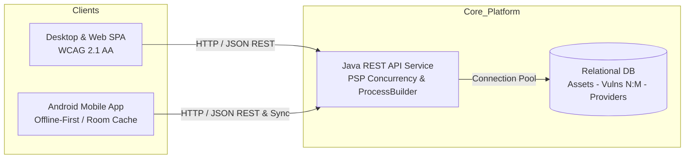
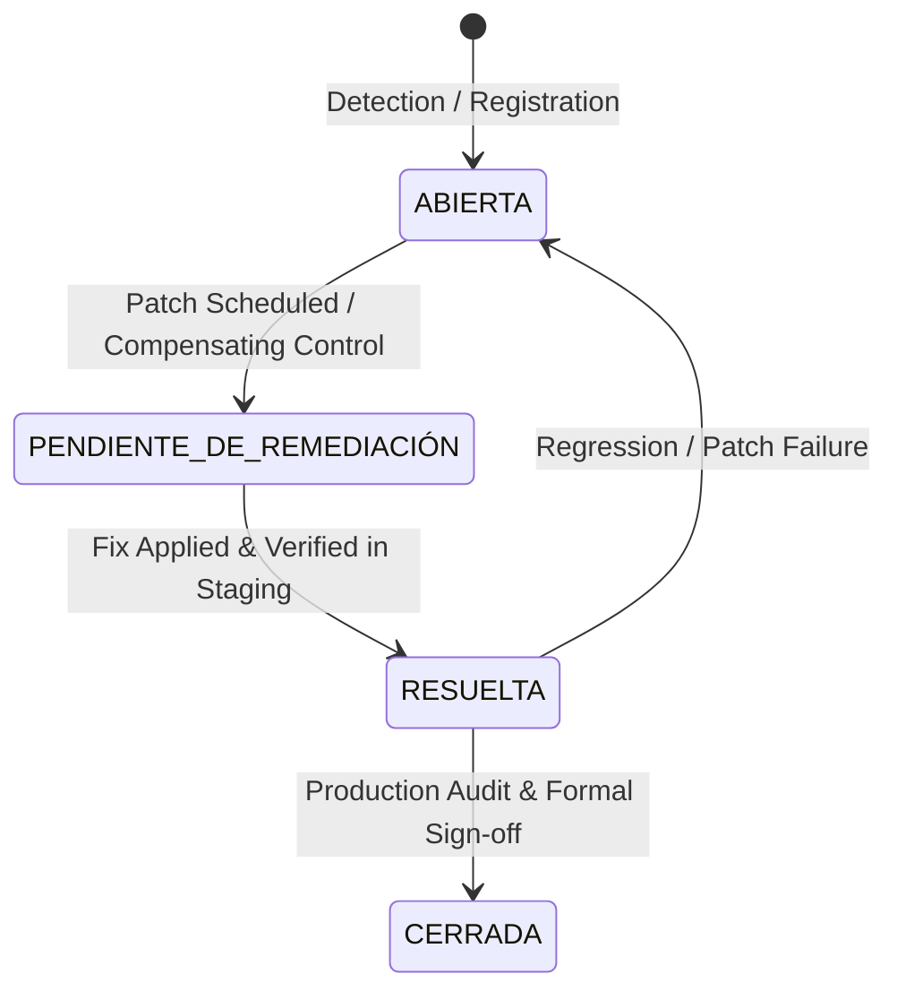

# VulnFollowUp

[](https://opensource.org/licenses/MIT)
[](https://eur-lex.europa.eu/eli/reg/2022/2554/oj)
[](https://www.oracle.com/java/)
[](https://www.w3.org/WAI/standards-guidelines/wcag/)

> **Enterprise Vulnerability Management & Operational Resilience Platform aligned with the EU Digital Operational Resilience Act (DORA - Regulation EU 2022/2554).**

---

## 1. Overview & Regulatory Context

Under the European Union **Digital Operational Resilience Act (DORA)**, financial entities (credit institutions, investment firms, payment service providers) and critical information and communication technology (**ICT**) third-party service providers must implement rigorous, automated mechanisms to detect, classify, prioritize, and remediate technical vulnerabilities across all mission-critical information assets.

**VulnFollowUp** is designed to streamline and automate this lifecycle by integrating:
- Automated **CVSS v3.1** and **CVSS v4.0** validation and base score scoring engines.
- DORA Chapter V Third-Party Risk Management mapping (connecting critical assets directly to external ICT vendors).
- A unified multi-tier architecture with multi-threaded server processing, an accessible web/desktop interface, and offline-first mobile inspection capabilities.

---

## 2. Architecture & Repository Structure

The project is structured as a single cohesive monorepo composed of 4 core modules:

```
VulnFollowUp/
├── backend/            # Java REST API (PSP, Acceso a Datos, SGE ICT Providers)
├── desktop-client/     # Component-based SPA Web & Desktop UI (Desarrollo de Interfaces, WCAG 2.1 AA)
├── android-app/        # Android Mobile App with Room local cache & offline sync (PMDM)
├── database/           # Relational schema DDL, ER diagram & SQL migrations (Acceso a Datos)
├── data/               # Synthetic seed datasets (20+ CVEs, Assets, DORA ICT Providers)
└── docs/               # Multi-modular documentation (API, English, IPE II, SGE, Digitalization, Sustainability)
```



---

## 3. User Roles & Security (RBAC)

The platform enforces strict Role-Based Access Control (**RBAC**). All passwords are cryptographically salted and hashed using modern algorithms (BCrypt / Argon2):

| Role | Permissions & Scope |
|---|---|
| **`ADMIN`** | Full platform administration, user lifecycle management, system-wide configuration, ICT provider onboarding, and global audit log inspection. |
| **`ANALYST`** | Vulnerability registration, CVSS validation, asset linkage, status progression (`ABIERTA` $\rightarrow$ `PENDIENTE DE REMEDIACIÓN` $\rightarrow$ `RESUELTA`), and assessment notes authoring. |
| **`VIEWER`** | Read-only access to dashboards, vulnerability registries, filtered queries, and pre-generated risk reports. Cannot alter status or settings. |

---

## 4. Vulnerability Lifecycle & CVSS Engine

### Lifecycle State Machine


### CVSS Validation Standard
- **Supported Standards**: CVSS v3.1 and CVSS v4.0.
- **Invariance Rules**:
  - The vector string prefix must match the recorded version (e.g., rejecting version `4.0` with `CVSS:3.1/...`).
  - Score range: `0.0` to `10.0`.
  - Severity mapping:
    - **`0.0`**: None (Ninguna)
    - **`0.1 - 3.9`**: Low (Baja)
    - **`4.0 - 6.9`**: Medium (Media)
    - **`7.0 - 8.9`**: High (Alta)
    - **`9.0 - 10.0`**: Critical (Crítica)
  - Coherence check: Rejecting inconsistent inputs (e.g. severity labeled "Low" with score `9.8`).

---

## 5. Core REST Endpoints

| Method | Endpoint | Description |
|---|---|---|
| `POST` | `/api/auth/login` | Authenticate user credentials and return JWT bearer token. |
| `GET` | `/api/assets` | Retrieve registered IT assets and their DORA criticality tiers. |
| `GET` | `/api/vulnerabilities` | Paginated and filtered query of vulnerabilities (Sustainable/Green). |
| `GET` | `/api/vulnerabilities/{id}` | Detailed single vulnerability view with full CVSS vector and assets. |
| `POST` | `/api/vulnerabilities` | Register a new vulnerability with validated CVSS scoring. |
| `PATCH`| `/api/vulnerabilities/{id}/status` | Execute state transition in the formal vulnerability lifecycle. |
| `POST` | `/api/vulnerabilities/{id}/assessment` | Attach technical triage, compensating controls, or remediation notes. |
| `GET` | `/api/dashboard/summary` | Aggregated executive KPIs (MTTR, open criticals, risk score). |
| `GET` | `/api/providers` | List DORA ICT third-party providers. |
| `POST` | `/api/providers` | Onboard an ICT service vendor under DORA Chapter V. |
| `GET` | `/api/providers/{id}/report` | Asynchronously export provider compliance and dependency report. |

---

## 6. Quick Setup & Developer Instructions

### Prerequisites
- **Java SE Development Kit (JDK)**: Version 17 or higher
- **Node.js**: Version 18 LTS or higher
- **Android Studio / SDK**: API Level 33+ (for Android client)
- **Git**: 2.30+

### Clone & Branch Setup
```bash
git clone https://github.com/Thepimen/VulnFollowUp.git
cd VulnFollowUp
git checkout develop
```

### Launch Backend Service
```bash
cd backend
# Using Maven wrapper (or installed mvn)
mvn clean spring-boot:run
```

### Launch Desktop / Web SPA Client
```bash
cd desktop-client
npm install
npm run dev
```

### Build Android Mobile Client
```bash
cd android-app
./gradlew assembleDebug
```

---

## 7. Educational & Vocational Context

This project represents the **Proyecto Intermodular** for the 2nd year of the Higher Vocational Training Degree in Multi-platform Application Development (**2.º DAM**):
- **PSP**: Thread safety, concurrency tests, `ExecutorService`, `ProcessBuilder`.
- **Acceso a Datos**: Normalization, N:M entities, indexing, DAO/Repository patterns.
- **Desarrollo de Interfaces**: Component architecture, UX, WCAG 2.1 AA accessibility.
- **PMDM**: Android client with Room database, offline resilience, and sync.
- **SGE**: DORA Chapter V ICT third-party risk management workflows.
- **Transversales**: English, IPE II, Digitalization, Sustainability / Green Software.

---

## 8. Authors

- **Development Team**: 2 Multi-platform Application Development Engineers (2.º DAM).
- **Institution**: Vocational Education & Training Center.
