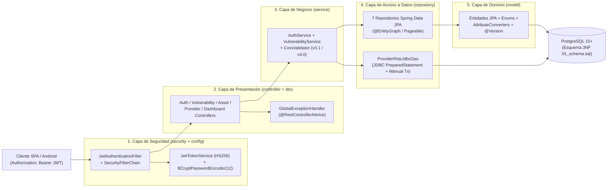

# Backend Service — VulnFollowUp REST API (2.º DAM)

Backend empresarial desarrollado en **Java 21** con **Spring Boot 3.3.5**, **Spring Security 6 + JWT (RFC 7519)**, **Spring Data JPA / Hibernate 6** y **JDBC puro** para la plataforma defensiva de gestión de vulnerabilidades técnicas y supervisión de proveedores TIC bajo el reglamento europeo **DORA (Reglamento UE 2022/2554)**.

---

## 1. Arquitectura Multapa del Backend

El servicio sigue una arquitectura limpia dividida en **6 capas desacopladas**, garantizando separación de responsabilidades, seguridad en profundidad (*Defense in Depth*) y trazabilidad transaccional ACID:



### Estructura de Paquetes (`src/main/java/com/vulnfollowup`)

```text
com.vulnfollowup
├── VulnFollowUpApplication.java     # Punto de entrada de Spring Boot
├── config/
│   ├── SecurityConfig.java          # Cadena SecurityFilterChain stateless, CORS y reglas RBAC por ruta
│   └── SecurityCryptoConfig.java    # Bean BCryptPasswordEncoder(12) con sal aleatoria por usuario
├── security/
│   ├── JwtTokenService.java         # Firma y validación RFC 7519 JWT (HMAC-SHA256 en tiempo constante)
│   └── JwtAuthenticationFilter.java # Filtro OncePerRequestFilter que hidrata el SecurityContextHolder
├── controller/
│   ├── AuthController.java          # Login con emisión de JWT (/api/auth/login) y healthcheck (/api/health)
│   ├── VulnerabilityController.java # CRUD paginado, ciclo de vida, re-evaluación CVSS e importación JSON
│   ├── AssetController.java         # Inventario paginado y alta de activos tecnológicos (/api/assets)
│   ├── ProviderController.java      # Gestión DORA de proveedores TIC e informe de riesgo (/api/providers)
│   ├── DashboardController.java     # KPIs ejecutivos agregados (/api/dashboard/summary)
│   ├── ReportController.java        # Exportación de informes CSV/HTML con ProcessBuilder (/api/reports/export)
│   └── GlobalExceptionHandler.java  # Traducción centralizada de excepciones a ApiErrorResponseDto
├── dto/
│   ├── ApiDtos.java                 # Records DTO de petición/respuesta sincronizados con OpenAPI 3.1
│   ├── LoginRequest.java            # Credenciales de entrada validadas con Jakarta Validation
│   ├── AuthResponse.java            # Resultado interno de autenticación y verificación de roles
│   ├── VulnerabilityCreateCommand.java # Comando inmutable de alta (API REST y lotes JSON)
│   ├── VulnerabilityImportDto.java  # Mapeo Jackson para importación/exportación masiva JSON
│   └── ProviderDoraRiskReportDto.java  # Proyección inmutable del informe agregador JDBC
├── service/
│   ├── AuthService.java             # Registro seguro BCrypt, login sin fuga de información y RBAC
│   ├── CvssValidator.java           # Motor puro sin estado para reglas FIRST CVSS v3.1 y v4.0
│   ├── VulnerabilityService.java    # Máquina de estados, auditoría inmutable y lotes JSON transaccionales
│   ├── PspConcurrencyAndProcessService.java # ReentrantLock, AtomicInteger, ThreadPoolExecutor y ProcessBuilder
│   └── PspReportWorker.java         # Subproceso independiente del SO invocado por ProcessBuilder
├── repository/
│   ├── VulnerabilityRepository.java # Consultas paginadas y @EntityGraph anti N+1
│   ├── AssetRepository.java         # Consultas de activos por proveedor y entorno
│   ├── TicProviderRepository.java   # Persistencia JPA de proveedores TIC
│   ├── UserRepository.java          # Búsqueda y verificación de unicidad de operadores
│   ├── CvssAssessmentRepository.java# Histórico 1:N de evaluaciones CVSS (uq_cvss_assessments_one_current)
│   ├── AuditLogRepository.java      # Inserción y consulta cronológica de trazas inmutables
│   ├── VulnerabilityAssetRepository.java # Gestión de la tabla asociativa N:M
│   └── ProviderRiskJdbcDao.java     # DAO JDBC puro con PreparedStatement, commit() y rollback() manual
└── model/
    ├── User.java, TicProvider.java, Asset.java, Vulnerability.java,
    │   VulnerabilityAsset.java, VulnerabilityAssetId.java, CvssAssessment.java, AuditLog.java
    ├── enums/                       # UserRole, VulnerabilityStatus, CvssVersion, CvssSeverity, etc.
    └── converter/                   # Convertidores JPA <-> Valor_BD exacto (incluyendo tildes y espacios)
```

---

## 2. Capa de Spring Security, Criptografía BCrypt y JWT (`config` + `security`)

1. **Protección de Contraseñas (`SecurityCryptoConfig` + `AuthService`)**:
   - Emplea `BCryptPasswordEncoder(12)` (factor de coste $2^{12}$ iteraciones con sal criptográfica aleatoria de 128 bits integrada en el propio hash `$2a$12$` / `$2b$12$`).
   - Prevención de enumeración de usuarios: usuario inexistente, contraseña errónea o cuenta inactiva devuelven exactamente el mismo mensaje genérico (`"Credenciales inválidas"`).
2. **Tokens JWT RFC 7519 (`JwtTokenService`)**:
   - Implementación nativa sobre `javax.crypto.Mac` (`HmacSHA256`) sin dependencias externas vulnerables.
   - **Pinning estricto de algoritmo**: exige `"alg": "HS256"` en la cabecera y rechaza cualquier intento de ataque con `"alg": "none"` o algoritmos no autorizados.
   - **Verificación en tiempo constante**: utiliza `MessageDigest.isEqual(...)` para impedir ataques laterales de temporización (*timing attacks*) sobre la firma.
   - Incluye los claims `sub` (username), `userId`, `role` (`ADMIN`, `ANALYST`, `VIEWER`), `iat` y `exp`.
3. **Filtro Stateless y Matriz RBAC (`JwtAuthenticationFilter` + `SecurityConfig`)**:
   - Sin sesiones HTTP en servidor (`SessionCreationPolicy.STATELESS`).
   - Configuración CORS habilitada para permitir peticiones desde el cliente de escritorio (`http://localhost:5173`) y móvil.
   - `AuthenticationEntryPoint` y `AccessDeniedHandler` personalizados que responden siempre en JSON estructurado (`401 UNAUTHORIZED` y `403 FORBIDDEN_ROLE`).

---

## 3. Catálogo de Endpoints REST y Matriz de Permisos RBAC

| Método | Endpoint | `ADMIN` | `ANALYST` | `VIEWER` | Descripción Funcional |
|---|---|:---:|:---:|:---:|---|
| `POST` | `/api/auth/login` | ✅ | ✅ | ✅ | Autentica con BCrypt y emite token Bearer JWT firmado (`HS256`). |
| `GET` | `/api/health` | ✅ | ✅ | ✅ | Comprobación de disponibilidad del servicio. |
| `GET` | `/api/dashboard/summary` | ✅ | ✅ | ✅ | KPIs agregados por severidad, estado y proveedores TIC en riesgo DORA. |
| `GET` | `/api/vulnerabilities` | ✅ | ✅ | ✅ | Búsqueda multicriterio con **paginación Green Software** (`size <= 100`). |
| `GET` | `/api/vulnerabilities/{id}` | ✅ | ✅ | ✅ | Detalle completo: activos N:M, histórico CVSS (`1:N`) y `audit_logs`. |
| `POST` | `/api/vulnerabilities` | ✅ | ✅ | ❌ (`403`) | Alta con validación CVSS v3.1/v4.0, activos vinculados y auditoría inicial. |
| `PATCH` | `/api/vulnerabilities/{id}/status` | ✅ *(Todos)* | ✅ *(Hasta `RESUELTA`)* | ❌ (`403`) | Transición en máquina de estados con registro inmutable en `audit_logs`. |
| `POST` | `/api/vulnerabilities/{id}/assessment` | ✅ | ✅ | ❌ (`403`) | Añade nueva evaluación CVSS desactivando la anterior (`is_current=false`). |
| `POST` | `/api/vulnerabilities/import` | ✅ | ✅ | ❌ (`403`) | Importación masiva JSON todo-o-nada (`ROLLBACK` automático ante fallo). |
| `DELETE` | `/api/vulnerabilities/{id}` | ✅ | ❌ (`403`) | ❌ (`403`) | Borrado administrativo (rechazado si existen registros en `audit_logs`). |
| `GET` | `/api/reports/export` | ✅ | ✅ | ❌ (`403`) | Generación de informe ejecutivo (`format=CSV` o `HTML`) mediante `ProcessBuilder`. |
| `GET` | `/api/assets` | ✅ | ✅ | ✅ | Listado paginado y filtrado de activos tecnológicos. |
| `POST` | `/api/assets` | ✅ | ✅ | ❌ (`403`) | Alta de activo tecnológico vinculado a un proveedor TIC. |
| `GET` | `/api/providers` | ✅ | ✅ | ✅ | Catálogo de proveedores TIC con cálculo en vivo de `doraRiskStatus`. |
| `POST` | `/api/providers` | ✅ | ❌ (`403`) | ❌ (`403`) | Homologación y alta de proveedor TIC bajo normativa DORA Cap. V. |
| `PUT` | `/api/providers/{id}` | ✅ | ❌ (`403`) | ❌ (`403`) | Actualización de estado contractual, criticidad o fecha de revisión DORA. |
| `GET` | `/api/providers/{id}/report` | ✅ | ✅ | ✅ | Informe DORA de riesgo de cadena de suministro (ej. `HostingSur S.L.`). |

### Contrato Uniforme de Errores (`GlobalExceptionHandler`)

| Código HTTP | `code` en JSON | Caso que lo dispara |
|---|---|---|
| `400 Bad Request` | `CVSS_COHERENCE_VIOLATION` | Vector no coincide con versión (`3.1`/`4.0`), nota fuera de `0.0..10.0` o severidad incoherente (ej. `9.8` con `LOW`). |
| `400 Bad Request` | `VALIDATION_ERROR` | Campos obligatorios vacíos, longitudes superadas o formato `VFU-XXXX` / `CVE-YYYY-NNNN` inválido. |
| `401 Unauthorized` | `UNAUTHORIZED` | Credenciales erróneas en login, token JWT ausente, expirado, manipulado o con `alg: "none"`. |
| `403 Forbidden` | `FORBIDDEN_ROLE` | Rol sin privilegios suficientes (ej. `VIEWER` intentando crear, o `ANALYST` intentando pasar a `CERRADA`). |
| `404 Not Found` | `RESOURCE_NOT_FOUND` | Vulnerabilidad, activo o proveedor TIC inexistente. |
| `409 Conflict` | `INVALID_STATE_TRANSITION` | Salto ilegal en el ciclo de vida (ej. `ABIERTA` $\rightarrow$ `CERRADA`). |
| `409 Conflict` | `DUPLICATE_RESOURCE` | Código `internal_code`/`cve_id` duplicado o conflicto de concurrencia optimista (`@Version`). |

---

## 4. Instrucciones de Compilación y Ejecución de Pruebas

### Arrancar el Backend en Local (Puerto `8080`)
```bash
cd VulnFollowUp/backend
mvn clean spring-boot:run
```

### Ejecutar Suite Unitaria, PSP, Generadores y Tests Web/Seguridad (sin Docker)
```bash
mvn test -Dtest="AuthAndVulnerabilityServiceUnitTest,GeneratorsTest,RestApiAndSecurityControllerTest,PspConcurrencyAndProcessTest"
```

### Ejecutar Suite Completa (incluye PostgreSQL 15 real en Testcontainers)
```bash
mvn test
```

| Clase de Prueba | Tipo | Cobertura Principal |
|---|---|---|
| `AuthAndVulnerabilityServiceUnitTest` | Unitaria (Mockito) | Login BCrypt real con los 4 usuarios del seed, ciclo de vida `VFU-0012`, fallo en 4.º registro JSON y validaciones previas al SQL. |
| `RestApiAndSecurityControllerTest` | Web / Seguridad (`@WebMvcTest`) | Emisión y validación JWT `HS256`, rechazo `401` (`alg=none` y firma alterada), matriz RBAC (`403`), exportación PSP y error `400` CVSS. |
| `PspConcurrencyAndProcessTest` | Concurrencia / Procesos (PSP) | Test de estrés multihilo (`32 x 1000` ops con `CountDownLatch`), validación paralela en `ThreadPoolExecutor` y subproceso `ProcessBuilder` CSV/HTML. |
| `GeneratorsTest` | Propiedades / Fuzzing | 100+ mutaciones deterministas por propiedad para enums, códigos `VFU`/`CVE`, activos repetidos/inexistentes y lotes corruptos. |
| `PostgresBackendIntegrationTest` | Integración (`Testcontainers`) | Carga `01_schema.sql` + `02_seed_data.sql` en PostgreSQL 15 real, rollback transaccional, `@Version`, `@EntityGraph` (1 SQL) y DAO JDBC. |
