# VulnFollowUp — 3NF Entity-Relationship Diagram (Mermaid)

> **Source of Truth DDL**: [`database/schema/01_schema.sql`](file:///c:/Users/luisl/OneDrive/Escritorio/Programacion%20y%20proyectos/VulnFollowUp/database/schema/01_schema.sql)  
> **Seed Script**: [`database/seed/02_seed_data.sql`](file:///c:/Users/luisl/OneDrive/Escritorio/Programacion%20y%20proyectos/VulnFollowUp/database/seed/02_seed_data.sql)  
> **Normalization Level**: Third Normal Form (3NF) with strict CVSS Base (`3.1` / `4.0`) & EU DORA Chapter V constraints.

---

## 1. Complete 3NF Entity-Relationship Diagram

```mermaid
erDiagram
    users {
        SERIAL id PK
        VARCHAR(50) username UK "NOT NULL"
        VARCHAR(120) email UK "NOT NULL"
        VARCHAR(100) full_name "NOT NULL"
        VARCHAR(255) password_hash "BCrypt ($2b$) or Argon2id hash (salt embedded, no separate column)"
        VARCHAR(20) role "CHECK: ADMIN | ANALYST | VIEWER"
        BOOLEAN is_active "DEFAULT TRUE"
        TIMESTAMPTZ created_at
        TIMESTAMPTZ updated_at
    }

    ict_providers {
        SERIAL id PK
        VARCHAR(20) provider_code UK "e.g. PROV-005"
        VARCHAR(120) name UK "e.g. HostingSur S.L."
        VARCHAR(150) provided_service "NOT NULL"
        VARCHAR(20) criticality "CHECK: LOW | MEDIUM | HIGH | CRITICAL"
        BOOLEAN is_critical_third_party "DORA CRITICAL_THIRD_PARTY flag; requires criticality HIGH or CRITICAL"
        VARCHAR(100) contract_reference "NOT NULL"
        VARCHAR(30) contract_status "CHECK: ACTIVE | UNDER_REVIEW | SUSPENDED | TERMINATED"
        DATE review_date "Next scheduled contract review (e.g. 2026-03-15)"
        VARCHAR(120) contact_email "NOT NULL"
        CHAR(2) country_code "ISO 3166-1 alpha-2"
        NUMERIC(5_2) sla_availability_pct "0.00 to 100.00"
        TIMESTAMPTZ created_at
        TIMESTAMPTZ updated_at
    }

    assets {
        SERIAL id PK
        VARCHAR(40) asset_code UK "e.g. AST-PAY-008"
        VARCHAR(120) name UK "e.g. API de pagos"
        VARCHAR(50) asset_type "CHECK: API_SERVICE | APPLICATION_SERVER | ..."
        VARCHAR(20) criticality "CHECK: LOW | MEDIUM | HIGH | CRITICAL"
        VARCHAR(30) environment "CHECK: PRODUCTION | STAGING | DEVELOPMENT | DR"
        VARCHAR(100) owner_department "NOT NULL"
        VARCHAR(45) ip_address "IPv4 / IPv6"
        VARCHAR(80) operating_system
        VARCHAR(30) status "CHECK: ACTIVE | MAINTENANCE | DECOMMISSIONED"
        INT provider_id FK "References ict_providers(id)"
        TIMESTAMPTZ created_at
        TIMESTAMPTZ updated_at
    }

    vulnerabilities {
        SERIAL id PK
        VARCHAR(20) internal_code UK "CHECK: ^VFU-[0-9]{4,}$ (e.g. VFU-0012)"
        VARCHAR(30) cve_id UK "CHECK: ^CVE-[0-9]{4}-[0-9]{4,}$ (synthetic, e.g. CVE-2026-90012)"
        VARCHAR(200) title "NOT NULL"
        TEXT description "NOT NULL"
        VARCHAR(30) status "CHECK: ABIERTA | PENDIENTE DE REMEDIACIÓN | RESUELTA | CERRADA"
        VARCHAR(10) cvss_version "CHECK: 3.1 | 4.0"
        VARCHAR(180) cvss_vector "CHECK: Matches CVSS:3.1/... or CVSS:4.0/... regex"
        NUMERIC(3_1) cvss_score "CHECK: 0.0 <= cvss_score <= 10.0"
        VARCHAR(20) severity "CHECK: Coherent with cvss_score (NONE..CRITICAL)"
        TEXT remediation_plan
        INT assigned_to FK "References users(id)"
        INT reported_by FK "References users(id)"
        DATE discovered_at
        DATE target_remediation_date
        TIMESTAMPTZ resolved_at "NOT NULL if and only if RESUELTA or CERRADA"
        TIMESTAMPTZ created_at
        TIMESTAMPTZ updated_at
    }

    vulnerability_assets {
        INT vulnerability_id PK,FK "References vulnerabilities(id) ON DELETE CASCADE"
        INT asset_id PK,FK "References assets(id) ON DELETE RESTRICT"
        VARCHAR(30) exposure_status "CHECK: AFFECTED | MITIGATED | PATCHED | RISK_ACCEPTED"
        TIMESTAMPTZ detected_at
        VARCHAR(500) notes
    }

    cvss_assessments {
        SERIAL id PK
        INT vulnerability_id FK "References vulnerabilities(id) ON DELETE CASCADE"
        INT assessed_by FK "References users(id)"
        VARCHAR(10) cvss_version "CHECK: 3.1 | 4.0"
        VARCHAR(180) cvss_vector "CHECK: Regex coherence with cvss_version"
        NUMERIC(3_1) cvss_score "CHECK: 0.0 <= cvss_score <= 10.0"
        VARCHAR(20) severity "CHECK: FIRST score-to-severity alignment"
        BOOLEAN is_current "UNIQUE per vulnerability WHERE is_current"
        TIMESTAMPTZ assessed_at
    }

    remediation_comments {
        SERIAL id PK
        INT vulnerability_id FK "References vulnerabilities(id) ON DELETE CASCADE"
        INT user_id FK "References users(id)"
        TEXT comment_text "NOT NULL"
        VARCHAR(255) evidence_url
        TIMESTAMPTZ created_at
    }

    audit_logs {
        SERIAL id PK
        INT vulnerability_id FK "References vulnerabilities(id) ON DELETE RESTRICT"
        INT user_id FK "References users(id)"
        VARCHAR(40) action_type "STATUS_TRANSITION | VULNERABILITY_CREATED | ..."
        VARCHAR(30) previous_status
        VARCHAR(30) new_status
        TEXT justification "NOT NULL; table is append-only (no UPDATE/DELETE/TRUNCATE)"
        TIMESTAMPTZ created_at
    }

    ict_providers ||--o{ assets : "provides / hosts (1:N)"
    users ||--o{ vulnerabilities : "assigned_to / reported_by (1:N)"
    vulnerabilities ||--|{ vulnerability_assets : "affects (N:M)"
    assets ||--o{ vulnerability_assets : "is affected by (N:M)"
    vulnerabilities ||--|{ cvss_assessments : "has CVSS evaluations (1:N)"
    users ||--o{ cvss_assessments : "evaluates (1:N)"
    vulnerabilities ||--o{ remediation_comments : "has follow-up comments (1:N)"
    users ||--o{ remediation_comments : "writes (1:N)"
    vulnerabilities ||--o{ audit_logs : "records state history (1:N)"
    users ||--o{ audit_logs : "executes audited action (1:N)"
```

---

## 2. Summary of 3NF Integrity & Domain Rules

1. **Mandatory N:M Associative Entity (`vulnerability_assets`)**: Resolves the many-to-many relationship between `vulnerabilities` and `assets` using composite primary key `(vulnerability_id, asset_id)` and per-asset `exposure_status`.
2. **EU DORA Chapter V Traceability (`ict_providers` $\rightarrow$ `assets` $\rightarrow$ `vulnerability_assets` $\rightarrow$ `vulnerabilities`)**: Enables deterministic calculation of whether an ICT third-party provider (e.g., **HostingSur S.L.**) is `AT_RISK` due to open/pending High or Critical vulnerabilities (e.g., **`VFU-0012`**, CVSS **9.8**, `PENDIENTE DE REMEDIACIÓN`) on its managed assets (e.g., **API de pagos**).
3. **Database-Enforced CVSS Coherence**: Both `vulnerabilities` and `cvss_assessments` enforce PostgreSQL regex and range `CHECK` constraints so invalid vectors (`cvss_version = '4.0'` with `CVSS:3.1/...`) or incoherent severity labels (`cvss_score = 9.8` with `LOW`) trigger immediate transactional rollback.

4. **Immutable Audit Trail**: `audit_logs` uses `ON DELETE RESTRICT` and the triggers `trg_audit_logs_no_update_delete` / `trg_audit_logs_no_truncate` so history can never be edited, deleted or silently cascaded away.
5. **Lifecycle Consistency**: `chk_vuln_resolved_at_matches_status` forces `resolved_at` to be set if and only if the status is `RESUELTA` or `CERRADA`; `uq_cvss_assessments_one_current` guarantees a single current CVSS assessment per vulnerability.
6. **Synthetic Data**: all CVE identifiers in the seed (`CVE-2026-90001` to `CVE-2026-90020`) are fictitious; CVSS scores were computed from each vector with the official FIRST formulas.
