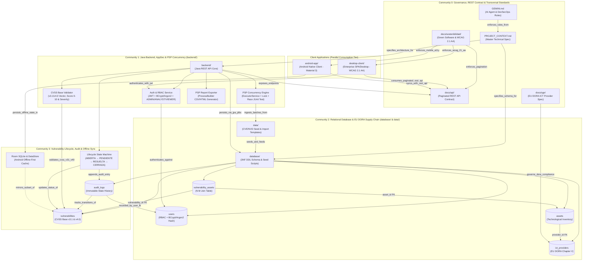
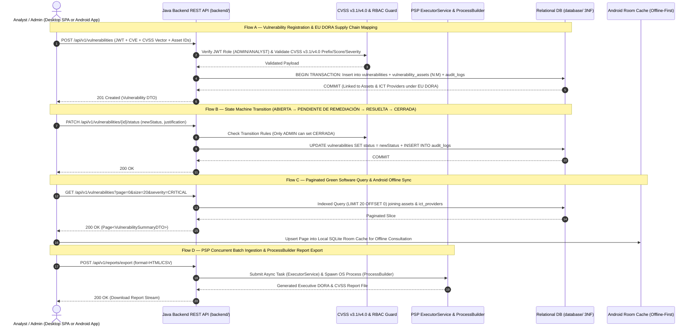
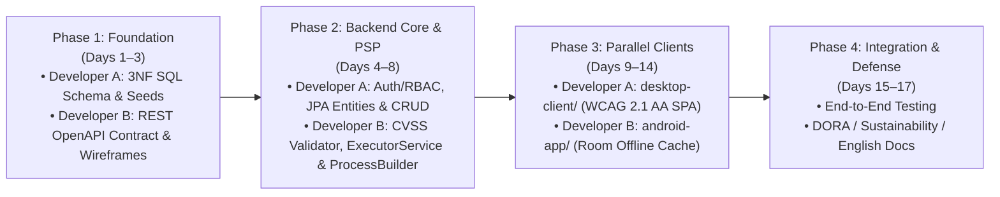

# VulnFollowUp — Project Architecture, Data Flow & Execution Order Graph

> **Generated by**: [`graphify`](file:///c:/Users/luisl/OneDrive/Escritorio/Programacion%20y%20proyectos/VulnFollowUp/.agents/skills/graphify/SKILL.md) Knowledge Graph Engine  
> **Raw Graph Artifacts**: [`graphify-out/graph.json`](file:///c:/Users/luisl/OneDrive/Escritorio/Programacion%20y%20proyectos/VulnFollowUp/graphify-out/graph.json) · [`graphify-out/GRAPH_REPORT.md`](file:///c:/Users/luisl/OneDrive/Escritorio/Programacion%20y%20proyectos/VulnFollowUp/graphify-out/GRAPH_REPORT.md) · [`graphify-out/graph.html`](file:///c:/Users/luisl/OneDrive/Escritorio/Programacion%20y%20proyectos/VulnFollowUp/graphify-out/graph.html)  
> **Scope**: Defensive Vulnerability & ICT Third-Party Risk Management Platform (EU DORA Regulation & CVSS Base v3.1/v4.0)

---

## 1. Executive Graph Summary (`graphify`)

Running the `graphify` extraction, clustering, and centrality analysis pipeline across the **VulnFollowUp** monorepo (`backend/`, `database/`, `desktop-client/`, `android-app/`, `data/`, `docs/`, `PROJECT_CONTEXT.md`, `GEMINI.md`, and `README.md`) produced a directed knowledge graph with:

- **24 Architectural Nodes · 41 Directed Edges · 2 Cross-Cutting Hyperedges · 4 Cohesive Communities**
- **Integrity Gate (`diagnose_extraction`)**: `0` dangling-endpoint edges, `0` missing-endpoint edges, `0` self-loops, `0` collapsed edges (**Graph Health: OK**).
- **Top "God Nodes" (Highest Centrality / Architectural Coupling)**:
  1. `database/ (3NF SQL Schema & Seed Scripts)` — **9 edges** (Betweenness centrality `0.080` — foundational persistence bridge)
  2. `backend/ (Java REST API & Business Logic)` — **8 edges** (Betweenness centrality `0.046` — central service & API hub)
  3. `PROJECT_CONTEXT.md (Master Technical Spec)` — **7 edges** (Betweenness centrality `0.107` — master governance bridge)
  4. `Table: vulnerabilities (CVE & CVSS Base v3.1/v4.0)` — **6 edges** (core domain entity)
  5. `Table: assets`, `Table: audit_logs`, `docs/api/`, `desktop-client/`, `android-app/` — **4 edges each**

---

## 2. System Architecture & Module Dependency Graph (Mermaid)



---

## 3. End-to-End Data Flow & State Lifecycle Graph



---

## 4. JSON Representation Summary (`graphify-out/graph.json`)

The full machine-readable GraphRAG JSON is stored in [`graphify-out/graph.json`](file:///c:/Users/luisl/OneDrive/Escritorio/Programacion%20y%20proyectos/VulnFollowUp/graphify-out/graph.json). Below is the structural summary of its communities, hyperedges, and core nodes:

```json
{
  "directed": true,
  "multigraph": false,
  "summary": {
    "total_nodes": 24,
    "total_edges": 41,
    "total_communities": 4,
    "extraction_breakdown": {
      "EXTRACTED": "95.1%",
      "INFERRED": "4.9%",
      "AMBIGUOUS": "0.0%"
    }
  },
  "communities": {
    "0": {
      "name": "Client Apps, REST API & Accessibility",
      "cohesion": 0.36,
      "key_nodes": ["PROJECT_CONTEXT.md", "GEMINI.md", "docs/api/", "desktop-client/", "android-app/", "docs/sostenibilidad/"]
    },
    "1": {
      "name": "Java Backend, Security & PSP Concurrency",
      "cohesion": 0.29,
      "key_nodes": ["backend/", "svc_auth_rbac", "svc_cvss_validator", "svc_psp_concurrency", "svc_psp_processbuilder", "tbl_users"]
    },
    "2": {
      "name": "Relational Database & EU DORA Supply Chain",
      "cohesion": 0.70,
      "key_nodes": ["database/", "docs/sge/", "tbl_ict_providers", "tbl_assets", "tbl_vulnerability_assets"]
    },
    "3": {
      "name": "Vulnerability Lifecycle, Audit & Offline Sync",
      "cohesion": 0.67,
      "key_nodes": ["tbl_vulnerabilities", "tbl_audit_logs", "svc_lifecycle_engine", "comp_room_cache"]
    }
  },
  "hyperedges": [
    {
      "id": "he_dora_supply_chain",
      "label": "EU DORA Supply Chain Risk Traceability (ICT Provider -> Asset -> Vulnerability)",
      "nodes": ["mod_sge_dora", "tbl_ict_providers", "tbl_assets", "tbl_vulnerability_assets", "tbl_vulnerabilities"]
    },
    {
      "id": "he_full_stack_contract",
      "label": "Paginated REST API Contract Across Backend, Desktop SPA, and Android App",
      "nodes": ["mod_backend", "spec_rest_api", "mod_desktop_client", "mod_android_app", "mod_sustainability_wcag"]
    }
  ]
}
```

---

## 5. Where to Start & Development Roadmap (2-Person Team Execution Order)

Because [`database/`](file:///c:/Users/luisl/OneDrive/Escritorio/Programacion%20y%20proyectos/VulnFollowUp/database/README.md) (`9 edges`) and [`backend/`](file:///c:/Users/luisl/OneDrive/Escritorio/Programacion%20y%20proyectos/VulnFollowUp/backend/README.md) (`8 edges`) are the highest-centrality **God Nodes** in the architecture graph, every downstream client (`desktop-client/` and `android-app/`) depends on their schema and REST contract.

To maximize parallel velocity between **Developer A** and **Developer B** without merge conflicts or blocking dependencies, follow this exact **4-Phase Dependency Roadmap**:



### Phase 1: Foundation — Database Schema & API Contract (Start Here Immediately)
> **Why start here?** In the Graphify centrality report, `database/` has 9 edges and `docs/api/` bridges the backend to both clients. Locking the SQL schema and REST JSON contract on Day 1 unblocks parallel work across the entire stack.

| Developer | Active Git Branch | Concrete Deliverables | Skills to Invoke |
|---|---|---|---|
| **Developer A** *(Data & Persistence Lead)* | `feat/database-schema-and-seed` | 1. Write `database/schema/01_schema.sql` (6 tables in 3NF: `users`, `ict_providers`, `assets`, `vulnerabilities`, `vulnerability_assets`, `audit_logs` with CVSS & status `CHECK` constraints and Green Software indexes).<br>2. Write `database/seed/02_seed_data.sql` + JSON templates in `data/` with realistic CVEs (CVSS v3.1 & v4.0), salted BCrypt password hashes for `ADMIN`/`ANALYST`/`VIEWER`, and EU DORA ICT providers. | `relational-database-sql`<br>`prioritizing-vulnerabilities-with-cvss-scoring`<br>`managing-third-party-vendor-risk` |
| **Developer B** *(API Contract & UI Wireframes Lead)* | `feat/frontend-wireframes-and-setup` & `docs/transversales-init` | 1. Define the paginated REST API endpoints and JSON DTO schemas in `docs/api/README.md` (`/api/v1/auth/login`, `/api/v1/vulnerabilities`, `/api/v1/assets`, `/api/v1/ict-providers`, `/api/v1/reports/export`).<br>2. Scaffold the base design tokens and WCAG 2.1 AA high-contrast layout shell in `desktop-client/`. | `implementing-api-schema-validation-security`<br>`design-taste-frontend`<br>`minimalist-ui` |

---

### Phase 2: Core Backend, AppSec & Mandatory PSP Mechanics
> **Dependency**: Requires Phase 1 SQL schema (`feat/database-schema-and-seed` merged into `develop`).

| Developer | Active Git Branch | Concrete Deliverables | Skills to Invoke |
|---|---|---|---|
| **Developer A** *(Core Domain, Auth & Persistence)* | `feat/backend-core-setup` | 1. Initialize Java backend project in `backend/` with JPA/JDBC connection to `database/`.<br>2. Implement `users` authentication (`BCrypt`/`Argon2id`), JWT issuance/verification, and `@PreAuthorize` RBAC (`ADMIN`, `ANALYST`, `VIEWER`).<br>3. Implement paginated CRUD repositories & services for `vulnerabilities`, `assets` (`N:M`), `ict_providers` (DORA), and `audit_logs`. | `implementing-jwt-signing-and-verification`<br>`relational-database-sql`<br>`test-driven-development` |
| **Developer B** *(CVSS Validation & PSP Concurrency/Processes)* | `feat/backend-core-setup` | 1. Implement strict **CVSS Base v3.1 & v4.0 Validator** (vector prefix regex, `0.0–10.0` range, score-to-severity coherence) and **State Lifecycle Engine** (`ABIERTA` $\rightarrow$ `PENDIENTE DE REMEDIACIÓN` $\rightarrow$ `RESUELTA` $\rightarrow$ `CERRADA`) with unit tests.<br>2. Implement **PSP Concurrency**: `ExecutorService` batch CVE processor + thread-safe shared counter (`ReentrantLock`/`AtomicInteger`) + **JUnit 5 Race Condition Test** (`CountDownLatch`).<br>3. Implement **PSP Process Execution**: `ProcessBuilder` service to export executive CSV/HTML reports safely. | `java-backend-concurrency`<br>`prioritizing-vulnerabilities-with-cvss-scoring`<br>`implementing-vulnerability-remediation-sla` |

---

### Phase 3: Parallel Client Development (Desktop SPA & Android Mobile App)
> **Dependency**: Requires Phase 2 REST endpoints running on `develop`. Both teammates now work 100% independently on separate client directories!

| Developer | Active Git Branch | Concrete Deliverables | Skills to Invoke |
|---|---|---|---|
| **Developer A** *(Desktop/Web SPA Lead — DI)* | `feat/frontend-wireframes-and-setup` | Build `desktop-client/`:<br>1. Login screen & role-aware navigation.<br>2. Executive Dashboard (KPI cards, severity distribution, DORA Critical ICT Provider alerts).<br>3. Paginated Vulnerability & Asset Management Table with CVSS v3.1/v4.0 badge visualization and state transition modal.<br>4. One-click CSV/HTML Report Export trigger (`ProcessBuilder` endpoint).<br>5. Verify **WCAG 2.1 AA** (contrast $\ge 4.5:1$, keyboard navigation, ARIA live regions). | `design-taste-frontend`<br>`high-end-visual-design`<br>`performing-web-application-vulnerability-triage` |
| **Developer B** *(Android Mobile Lead — PMDM)* | `feat/android-offline-client` *(branched from `develop`)* | Build `android-app/`:<br>1. Material 3 Login (`EncryptedSharedPreferences` / DataStore for JWT).<br>2. **Room SQLite Local Database** (`VulnerabilityEntity`, `AssetEntity`, `PendingStatusChangeEntity`).<br>3. Offline-First Repository with Retrofit sync and "Offline Mode" banner.<br>4. Mobile CVE Detail & Status Transition screen for field analysts (`48x48dp` touch targets, TalkBack labels). | `android-offline-room`<br>`test-driven-development` |

---

### Phase 4: End-to-End Integration, Security Audit & Academic Defense
> **Dependency**: Merge Phase 3 branches into `develop`, run `graphify --update`, and prepare `main` release.

1. **Automated Verification & Code Review**: Run JUnit 5 suite (CVSS validation, state transitions, PSP concurrency race test, `ProcessBuilder` export) and OWASP Top 10 defensive audit using `requesting-code-review` and `verification-before-completion`.
2. **Transversal Documentation (`docs/transversales-init`)**: Finalize EU DORA compliance report (`docs/sge/`), Green Software & WCAG 2.1 AA audit (`docs/sostenibilidad/`), and English Executive Summary (`docs/english/`).
3. **Architecture Graph Refresh**: Run `/graphify . --update` to capture all newly written Java, SQL, Frontend, and Kotlin source files into `graphify-out/` before merging `develop` $\rightarrow$ `main`.
