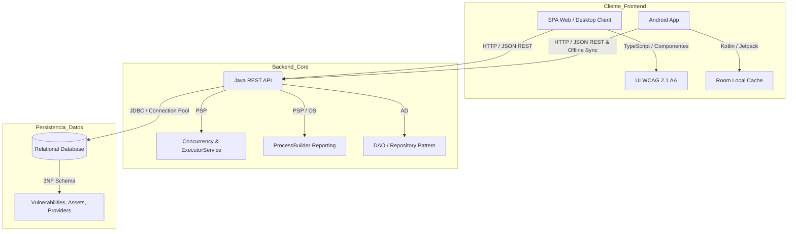

# Módulo Digitalización - VulnFollowUp

Informe de transformación digital, mapa tecnológico del ecosistema y diagrama de flujo de datos para **VulnFollowUp**.

---

## 1. Informe de Transformación Digital

### Situación de Partida (As-Is)
- Gestión de vulnerabilidades manual basada en ficheros Excel y correos electrónicos no cifrados.
- Respuestas reactivas y desconexión entre el equipo de infraestructura de IT y los responsables de cumplimiento legal.
- Pérdida de trazabilidad: cambios de estado sin justificación formal ni registro cronológico inmutable.

### Situación Objetivo (To-Be con VulnFollowUp)
- **Centralización y Automatización**: Ingesta asíncrona de boletines de vulnerabilidad y cálculo automático de CVSS.
- **Resiliencia Operativa DORA**: Monitorización continua de activos bancarios y proveedores TIC en tiempo real.
- **Acceso Multiplataforma**: Portal web/escritorio para análisis profundo y aplicación móvil para respuesta ágil en movilidad.

---

## 2. Mapa de Tecnologías (Technology Stack Radar)

---

## 3. Flujo de Datos del Sistema (Data Flow Diagram)

1. **Ingesta y Registro**:
   - Fuentes externas o analistas introducen un CVE mediante `POST /api/vulnerabilities`.
   - El motor de validación comprueba la integridad del vector CVSS y asigna la severidad correspondiente.
2. **Asociación de Activos y Proveedores TIC**:
   - Se crea el vínculo N:M entre la vulnerabilidad y los activos afectados (`vulnerability_assets`).
   - Se deduce el impacto en el proveedor TIC responsable del activo (SGE).
3. **Notificación y Consulta**:
   - Los dashboards web consultan `GET /api/dashboard/summary` y tablas paginadas.
   - La app móvil descarga los datos mediante `GET /api/vulnerabilities` y los persiste en su base de datos local SQLite/Room.
4. **Transición y Auditoría**:
   - El analista actualiza el estado mediante `PATCH /api/vulnerabilities/{id}/status`.
   - Se escribe un registro inmutable en `status_history`.
5. **Generación Externa de Informes**:
   - El backend lanza un proceso externo con `ProcessBuilder` para exportar informes CSV/HTML sin bloquear el servidor.
