# Arquitectura del Flujo del Dato y Mapa de Tecnologías Habilitadoras Digitales (THD)

## 1. Visión General de la Digitalización en VulnFollowUp

En las pequeñas y medianas entidades financieras, aseguradoras y proveedores tecnológicos europeos, la gestión de vulnerabilidades de ciberseguridad y el control de contratos de proveedores TIC solían operar en **silos desconectados**: el equipo técnico anotaba avisos CVE en hojas de cálculo o correos electrónicos, mientras que el departamento de compras o administración renovaba contratos de proveedores críticos sin visibilidad sobre las brechas técnicas abiertas en dichos servicios.

**VulnFollowUp** digitaliza y unifica extremo a extremo este proceso bajo el marco del **Reglamento (UE) 2022/2554 (DORA)**, transformando datos técnicos brutos (boletines CVE y vectores CVSS v3.1/v4.0) en **inteligencia de negocio y gobernanza contractual (SGE)** en tiempo real.

---

## 2. Diagrama del Viaje del Dato (End-to-End Data Flow Architecture)

El siguiente diagrama modela las **6 etapas del ciclo de vida del dato** dentro de la plataforma, desde su ingesta hasta la toma de decisiones ejecutivas:

```mermaid
flowchart LR
    subgraph S1["1. Fuentes e Ingesta"]
        F1["Boletines CVE / Advisories\n(JSON Lote Masivo)"]
        F2["Reporte Manual Analista\n(Formulario SPA / API)"]
    end

    subgraph S2["2. Validación y Cálculo Concurrente (Backend & PSP)"]
        V1["Validador de Esquema API\n(Regex CVSS v3.1 / v4.0)"]
        V2["Pool ExecutorService (PSP)\n+ ProcessBuilder Python"]
        V3["Gestor Transaccional AD\n(ACID Commit / Rollback)"]
    end

    subgraph S3["3. Persistencia Relacional 3NF (PostgreSQL)"]
        DB1[("vulnerabilities &\ncvss_assessments")]
        DB2[("vulnerability_assets\n(Relación N:M)")]
        DB3[("assets &\nict_providers")]
        DB4[("audit_logs\n(Inmutable)")]
    end

    subgraph S4["4. Exposición Segura API REST"]
        API1["Control Acceso RBAC\n(ADMIN / ANALYST / VIEWER)"]
        API2["Serialización Paginada\nPageResponse<T> (JSON)"]
    end

    subgraph S5["5. Consumo Multiplataforma y Caché"]
        C1["Cliente Escritorio SPA\n(React + TS + WCAG 2.1 AA)"]
        C2["App Móvil Android\n(Kotlin + Room Offline DB)"]
    end

    subgraph S6["6. Decisión de Negocio (SGE & DORA)"]
        D1["Semáforo de Riesgo TIC\n(Ej. HostingSur S.L. / VFU-0012)"]
        D2["Bloqueo Preventivo de\nRenovación Contractual"]
    end

    F1 & F2 --> V1
    V1 --> V2 --> V3
    V3 -->|"Transacción Atómica"| DB1 & DB2 & DB4
    DB2 <--> DB3
    DB1 & DB3 & DB4 --> API1 --> API2
    API2 -->|"HTTPS Paginado"| C1 & C2
    C1 & C2 --> D1 --> D2
```

### Trazabilidad Paso a Paso del Dato (Caso Real: `VFU-0012` -> `HostingSur S.L.`)

1. **Captura e Ingesta**: Se recibe un lote JSON (`data/vulnerabilities_seed.json`) o un alta manual que reporta la vulnerabilidad **`VFU-0012`** (*Unauthenticated SQL Injection in Payment Settlement Webhook*, `CVE-2026-1012`) con el vector `CVSS:3.1/AV:N/AC:L/PR:N/UI:N/S:U/C:H/I:H/A:H`.
2. **Validación Defensiva y Cálculo Concurrente (`PSP`)**:
   - El backend valida que el usuario tenga rol `ADMIN` o `ANALYST` y verifica la estructura del payload antes de tocar la base de datos.
   - Si se requiere verificación de vector o lote masivo, el pool de hilos acotado (`ExecutorService`) invoca de forma segura el motor auxiliar mediante `ProcessBuilder` con lista de argumentos (sin intérprete de comandos) y verifica que la puntuación resultante es **9.8 (`CRITICAL`)**.
3. **Persistencia Transaccional (`Acceso a Datos`)**:
   - Dentro de una única transacción SQL (`BEGIN ... COMMIT`), se inserta la vulnerabilidad `VFU-0012` en estado `'PENDIENTE DE REMEDIACIÓN'`, su valoración en `cvss_assessments`, su vínculo en la tabla intermedia N:M `vulnerability_assets` apuntando al activo **`API de pagos`** (`AST-PAY-001`), y la traza correspondiente en `audit_logs`.
   - Si cualquier fila del lote incumple las restricciones `CHECK` (como ocurre deliberadamente en el 4.º registro de `data/vulnerabilities_invalid_rollback_test.json`), el motor ejecuta `ROLLBACK` total garantizando **cero corrupción parcial**.
4. **Agregación SGE y Cruce con Proveedores TIC**:
   - Mediante la relación `vulnerabilities` <-> `vulnerability_assets` <-> `assets` <-> `ict_providers`, el sistema detecta instantáneamente que el activo `API de pagos` pertenece al proveedor externo **«HostingSur S.L.»** (criticidad `HIGH`, fecha de revisión contractual `2026-03-15`).
5. **Distribución Eficiente y Consumo Accesible**:
   - El endpoint `GET /api/providers` y `GET /api/vulnerabilities` sirve los datos en páginas de 20 elementos (`PageResponse<T>`).
   - El cliente de escritorio (`desktop-client/`) renderiza la alerta mediante componentes accesibles **WCAG 2.1 AA** (icono geométrico + borde + texto explícito), mientras que la app Android almacena el snapshot en su base de datos local **Room** para consulta sin cobertura de red.
6. **Toma de Decisiones Ejecutiva (Gobernanza DORA)**:
   - En la vista SGE de Proveedores TIC, el responsable de seguridad y compras visualiza que **«HostingSur S.L.»** infringe la regla **BR-SGE-01** (`VFU-0012`, CVSS 9.8 Crítica en `PENDIENTE DE REMEDIACIÓN` con revisión en marzo), activando el bloqueo preventivo de renovación hasta que el proveedor certifique el parcheo y la vulnerabilidad pase a `RESUELTA` / `CERRADA`.

---

## 3. Mapa de Tecnologías Habilitadoras Digitales (THD) Aplicadas

| Tecnología Habilitadora Digital (THD) | Aplicación Concreta en **VulnFollowUp** | Impacto en el Negocio y la Seguridad |
| :--- | :--- | :--- |
| **1. Ciberseguridad Defensiva y Gestión Continua de Exposición (CTEM / CVSS v3.1 & v4.0)** | Motor de validación dual capaz de interpretar y verificar vectores tanto de **CVSS v3.1** como del nuevo estándar **CVSS v4.0**, junto con control de acceso basado en roles (**RBAC**: `ADMIN`, `ANALYST`, `VIEWER`), hashing **BCrypt + Salt** y registro inmutable de auditoría (`audit_logs`). | Elimina la clasificación subjetiva de riesgos, impide manipulaciones no autorizadas de estados de vulnerabilidad y proporciona evidencias forenses listas para inspección regulatoria. |
| **2. Automatización RegTech y Gobernanza de Cadena de Suministro (EU DORA Compliance)** | Motor de reglas de negocio SGE (**BR-SGE-01 a BR-SGE-04**) que cruza automáticamente el inventario técnico de activos (`assets`) con los contratos de proveedores TIC (`ict_providers`) y sus fechas de vencimiento (`next_review_date`). | Sustituye revisiones manuales en hojas de cálculo por alertas tempranas automatizadas, evitando renovar contratos con proveedores tecnológicos que mantienen brechas críticas sin resolver. |
| **3. Arquitecturas Desacopladas API-First (OpenAPI 3.1) y Movilidad Offline-First (Edge Cache)** | Contrato formal **OpenAPI 3.1** (`docs/api/openapi.yaml`) que alimenta simultáneamente un panel SPA de escritorio (React + TypeScript) y una app nativa Android con persistencia local en **SQLite / Room**. | Permite a los analistas de guardia consultar el estado de activos críticos incluso en centros de datos sin cobertura móvil, reduciendo además el tráfico de red redundante. |
| **4. Computación Concurrente Segura e Integración Políglota (Java + Python)** | Ejecución paralela controlada mediante `ExecutorService` y comunicación inter-proceso segura (`ProcessBuilder` sin shell) con scripts especializados de validación y análisis en Python. | Acelera el procesamiento de lotes masivos de vulnerabilidades manteniendo el aislamiento de memoria y previniendo ataques de inyección de comandos (*Command Injection*). |
| **5. Grafos de Conocimiento de Ingeniería (`Graphify` Knowledge Graph)** | Generación automatizada del grafo de dependencias arquitectónicas (`docs/architecture-graph.md` y `graphify-out/graph.json`) que vincula tablas SQL, contratos OpenAPI, servicios backend y componentes UI. | Garantiza trazabilidad total del impacto ante cambios de esquema o API para el equipo de desarrollo. |
