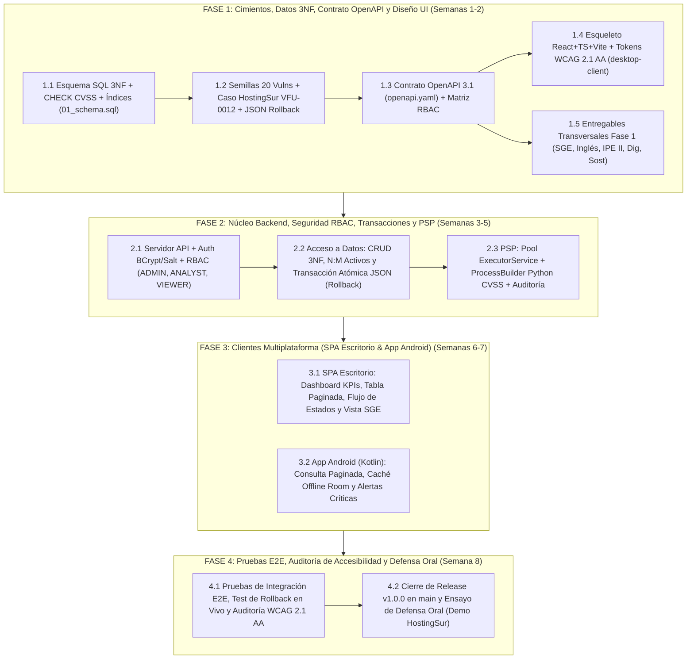

# Planificación del Proyecto, Reparto de Roles (2 Personas) y Modelo de Negocio (IPE II)

## 1. Contexto de Equipo y Reparto Equitativo de Roles (Equipo de 2 Desarrolladores)

El proyecto intermodular **VulnFollowUp** es desarrollado por un equipo de **2 integrantes de 2.º DAM** (**Developer A — `NoeCB`** y **Developer B — `luisl`**), operando bajo una metodología **Scrum-ban iterativa en 4 fases** y flujo de ramas **Gitflow** (`main` <- `develop` <- `feat/*`, `docs/*`, `fix/*`).

Para garantizar que ambos miembros dominen extremo a extremo la arquitectura del sistema para la defensa oral y evitar cuellos de botella, la carga técnica y transversal se divide de forma simétrica:

| Ámbito / Módulo | **Developer A (`NoeCB`)** — *Lead Backend, Concurrencia & Datos* | **Developer B (`luisl`)** — *Lead DevSecOps, Clientes (SPA/Android), QA DB & SGE* |
| :--- | :--- | :--- |
| **Base de Datos (`database/`, `data/`)** | Diseño inicial E-R y DDL preliminar (`database1-schema.sql`, `database2-schema.sql`), carga de datos semilla (`providers_seed.json`, `assets_seed.json`). | Auditoría QA 3NF, restricciones `CHECK` de coherencia CVSS v3.1/v4.0, índices compuestos, caso oficial `HostingSur S.L. / VFU-0012` y test de rollback (`01_schema.sql`, `02_seed_data.sql`). |
| **Contrato API (`docs/api/`)** | Revisión e implementación de controladores REST y filtros de seguridad en el servidor. | Autoría de la especificación formal **OpenAPI 3.1** (`openapi.yaml`), matriz RBAC y contratos paginados (`PageResponse<T>`). |
| **Backend (`backend/`)** | Núcleo transaccional JDBC/JPA (carga masiva atómica con rollback), autenticación BCrypt + Salt y endpoints de Vulnerabilidades/CVSS. | Concurrencia segura en `PSP` (`ExecutorService` acotado, `ProcessBuilder` sin shell para script Python CVSS, `ConcurrentHashMap`), endpoints SGE/Proveedores TIC y Auditoría. |
| **Cliente Escritorio (`desktop-client/`)** | Integración de vistas de detalle de vulnerabilidades, calculadora interactiva CVSS y exportación de informes. | Arquitectura base React 18 + TypeScript + Vite, sistema de diseño **WCAG 2.1 AA** (Dark/Light), `SeverityBadge` / `StatusBadge` no dependientes solo del color, vistas SGE y Dashboard. |
| **App Móvil (`android-app/`)** | Pantalla de detalle de vulnerabilidad, filtrado por estado y pruebas en emulador Android. | Arquitectura Kotlin + Jetpack Compose + Material 3, caché local **Room** (modo offline) y sincronización paginada con `Retrofit`. |
| **Módulos Transversales** | Apoyo en pruebas de rendimiento backend y validación de métricas energéticas. | Modelado BPMN DORA (`SGE`), Glosario + Executive Summary (`Inglés`), Lean Canvas + DAFO + Actas (`IPE II`), Mapa THD (`Digitalización`) y Línea Base Green Software (`Sostenibilidad`). |

---

## 2. Hoja de Ruta y Diagrama de Gantt (4 Fases de Desarrollo)

El calendario de trabajo se estructura en **4 fases secuenciales con hitos de integración en `develop`**:

### Cronograma Detallado por Fase

| Fase | Nombre del Hito | Ramas Git Asociadas | Criterio de Aceptación (Definition of Done) |
| :--- | :--- | :--- | :--- |
| **Fase 1** | **Fundamentos, Datos 3NF y Contratos** | `feat/database-schema-and-seed`, `feat/frontend-wireframes-and-setup`, `docs/transversales-init` | Esquema 3NF validado, 20 vulnerabilidades semilla con caso `HostingSur S.L. / VFU-0012`, `openapi.yaml` completo, SPA compilando a `0` errores TypeScript y documentación transversal base fusionada en `develop`. |
| **Fase 2** | **Backend Core, AD y Concurrencia PSP** | `feat/backend-core-setup`, `feat/backend-cvss-concurrency` | API REST operativa cumpliendo `openapi.yaml`, login con BCrypt+salt, importación JSON con demostración de `ROLLBACK` ante el registro corrupto `#4`, y validador externo Python invocado de forma segura con `ProcessBuilder` y `ExecutorService`. |
| **Fase 3** | **Clientes Escritorio (DI) y Móvil (PMDM)** | `feat/desktop-sge-and-workflows`, `feat/android-offline-client` | Cliente React conectado al backend con transición de estados (`ABIERTA` -> `PENDIENTE DE REMEDIACIÓN` -> `RESUELTA` -> `CERRADA`) y ficha SGE DORA; app Android mostrando alertas con caché local `Room` sin red. |
| **Fase 4** | **QA, Sostenibilidad Empírica y Release** | `release/v1.0.0` -> `main` | Batería de tests unitarios/integración en verde, contraste WCAG 2.1 AA verificado, comparativa real de bytes/consumo documentada y fusión final en `main`. |

---

## 3. Estructura del Tablero Kanban del Equipo

El seguimiento diario se realiza mediante un tablero Kanban de **5 columnas** con límite de trabajo en curso (*WIP Limit = 2 tareas por desarrollador*):

1. **Backlog (Pila de Producto)**: Historias de usuario priorizadas por valor normativo DORA y dependencias técnicas (primero `database/`, luego `backend/`, después clientes).
2. **Ready for Dev (Seleccionado para Sprint)**: Tareas con contrato de datos (`01_schema.sql` / `openapi.yaml`) ya cerrado y sin bloqueos.
3. **In Progress (En Curso — WIP máx. 2/persona)**: Rama `feat/*` activa en local.
4. **Code Review & QA Check**: Pull Request interna entre Developer A y Developer B verificando compilación limpia, reglas OWASP Top 10 y cumplimiento de `GEMINI.md`.
5. **Done (Integrado en `develop`)**: Fusionado con `git merge --no-ff` y trazado en el grafo arquitectónico (`docs/architecture-graph.md`).

---

## 4. Modelo de Negocio: Lean Canvas (Orientado a PYMEs Financieras y Seguros bajo DORA)

| Bloque Lean Canvas | Definición Estratégica para **VulnFollowUp** |
| :--- | :--- |
| **1. Problema** | 1. Desde el **17 de enero de 2025**, el **Reglamento (UE) 2022/2554 (DORA)** obliga a entidades financieras, corredurías de seguros y fintechs europeas a auditar continuamente tanto sus vulnerabilidades técnicas como el riesgo de sus proveedores TIC terceros. 2. Las PYMEs del sector siguen gestionando CVE y contratos TIC en hojas Excel inconexas, sin trazabilidad entre qué vulnerabilidad (`VFU-0012`) afecta a qué proveedor crítico (`HostingSur S.L.`). 3. Las suites empresariales (ServiceNow GRC, Tenable Lumin) superan los 35.000 €/año y son inasumibles e innecesariamente complejas para equipos técnicos de 2 a 15 personas. |
| **2. Segmentos de Clientes** | - **Early Adopters**: PYMEs financieras europeas, entidades de pago, agencias de valores, corredurías de seguros y cooperativas de crédito sujetas a DORA. - Proveedores TIC críticos (*Managed Service Providers*, pasarelas de pago, hostings especializados) que necesitan acreditar cumplimiento ante clientes bancarios. |
| **3. Propuesta de Valor Única (UVP)** | *"Trazabilidad unificada entre vulnerabilidades técnicas (CVSS v3.1/v4.0) y gobernanza de proveedores TIC bajo normativa europea DORA:100 % defensiva, auditable y desplegable en minutos sin costes de licencia desorbitados."* |
| **4. Solución** | - **Registro 3NF unificado**: Vinculación directa N:M entre vulnerabilidades (`VFU-XXXX`), activos tecnológicos y proveedores TIC. - **Motor dual CVSS v3.1 y v4.0**: Validación sintáctica y matemática estricta sin ambigüedades. - **Semáforo SGE de Renovación Contractual**: Bloqueo visual automático de renovaciones de contratos TIC cuando existen vulnerabilidades críticas/altas pendientes. - **Acceso Multiplataforma Accesible (WCAG 2.1 AA)** y app Android con caché offline (`Room`) para guardias de incidentes. |
| **5. Canales** | - Distribución *Open-Core* / Autoalojada (Docker Compose On-Premise para soberanía de datos). - Auditorías y consultoras de cumplimiento normativo (ISO 27001 / ENS / DORA). - Asociaciones sectoriales de Fintech, Insurtech y colegios profesionales. |
| **6. Flujos de Ingresos** | - **Edición Community (Autoalojada)**: Gratuita para microempresas y entornos académicos. - **Suscripción B2B SaaS / Enterprise On-Premise**: 199 €/mes (hasta 50 activos y 15 proveedores TIC) o 499 €/mes (activos ilimitados, informes ejecutivos DORA firmados y soporte SLA 24x7). |
| **7. Estructura de Costes** | - Desarrollo y mantenimiento de software (equipo de ingeniería DevSecOps). - Infraestructura cloud ligera y eficiente (*Green Software*: bajo consumo de CPU/RAM gracias a paginación estricta y ausencia de telemetría pesada). - Actualización continua de diccionarios normativos (DORA RTS, NIST NVD / CVSS v4.0). |
| **8. Métricas Clave (KPIs)** | - **MTTD / MTTR**: Tiempo medio de remediación de vulnerabilidades críticas en activos de proveedores TIC. - **Tasa de Cobertura DORA**: % de proveedores TIC críticos con auditoría técnica al día antes de su fecha de revisión (`next_review_date`). - **Eficiencia de Red (Green KPI)**: Bytes transferidos por consulta (< 10 KB por página de 20 registros). |
| **9. Ventaja Injusta (Diferencial)** | - Diseño nativo específico para el binomio **Técnico (CVSS v3.1/v4.0) + Contractual (DORA Art. 28)** en una sola base de datos relacional ligera, frente a herramientas que solo hacen escaneo técnico o solo gestión documental legal. |

---

## 5. Análisis DAFO (SWOT) del Producto

| | **Factores Positivos (Impulsores)** | **Factores Negativos (Retos a Mitigar)** |
| :--- | :--- | :--- |
| **Análisis Interno (Producto y Equipo)** | **FORTALEZAS (Strengths)** - **F1.** Integración nativa entre vulnerabilidades técnicas (CVSS v3.1/v4.0) y contratos de proveedores TIC (SGE). - **F2.** Integridad de datos blindada en 3NF con transacciones atómicas y registro de auditoría inmutable (`audit_logs`). - **F3.** Cumplimiento estricto **WCAG 2.1 AA** y criterios **Green Software** (paginación obligatoria, caché local en Android). - **F4.** Enfoque 100 % defensivo, ético y alineado con soberanía del dato (*On-Premise*). | **DEBILIDADES (Weaknesses)** - **D1.** Equipo reducido de 2 desarrolladores con tiempo acotado al calendario académico de 2.º DAM. - **D2.** La versión 1.0 no incluye escaneo activo de red (por diseño ético y alcance defensivo), requiriendo ingesta vía API/JSON o registro manual. - **D3.** Menor reconocimiento de marca inicial frente a fabricantes consolidados de ciberseguridad. |
| **Análisis Externo (Mercado y Regulación)** | **OPORTUNIDADES (Opportunities)** - **O1.** Entrada en vigor obligatoria del **Reglamento europeo DORA (UE 2022/2554)** y la directiva **NIS2**, que fuerzan a miles de PYMEs a auditar su cadena de suministro TIC. - **O2.** Transición de la industria desde **CVSS v3.1 hacia CVSS v4.0**, donde muchas herramientas heredadas aún no validan vectores `CVSS:4.0/...`. - **O3.** Creciente exigencia de accesibilidad digital (Acta Europea de Accesibilidad) y sostenibilidad TI en compras públicas y privadas. | **AMENAZAS (Threats)** - **A1.** Competidores GRC tradicionales que añadan módulos simplificados para PYMEs. - **A2.** Fatiga de alertas en los equipos de seguridad si no se prioriza adecuadamente. - **A3.** Cambios en los estándares técnicos de intercambio de vulnerabilidades o en los *Regulatory Technical Standards (RTS)* de DORA. |
