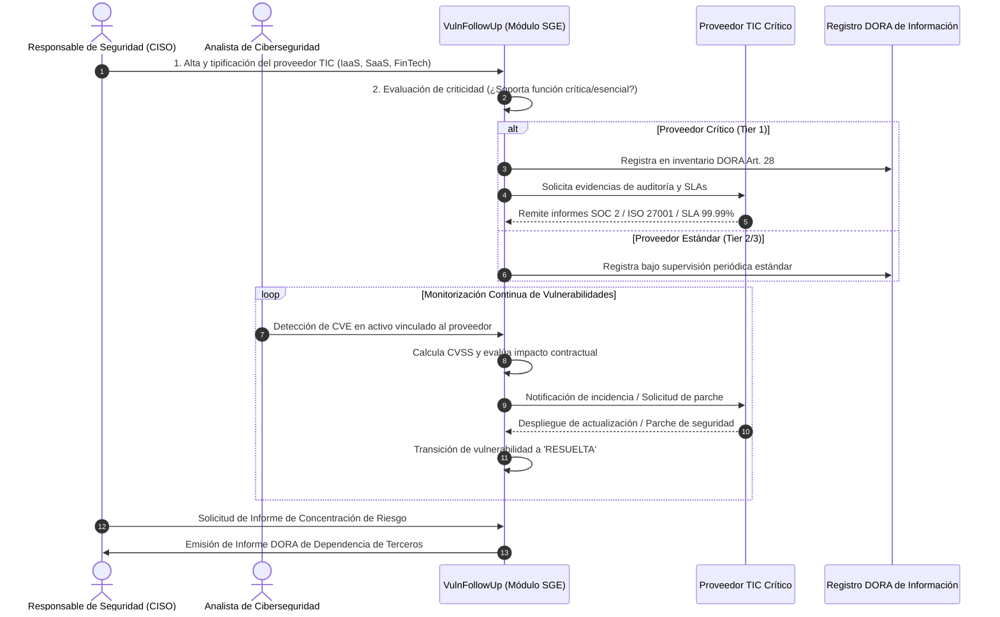

# Módulo SGE (Sistemas de Gestión Empresarial) - VulnFollowUp

Gestión del riesgo derivado de terceros proveedores de servicios TIC bajo los requisitos del **Reglamento (UE) 2022/2554 (DORA - Capítulo V, Artículos 28 a 44)**.

---

## 1. Diagrama BPMN del Proceso de Gestión de Proveedores TIC

A continuación se detalla el flujo de gestión y homologación continua de proveedores TIC en notación de proceso de negocio (BPMN):

---

## 2. Reglas de Negocio DORA (Capítulo V)

1. **Clasificación Obligatoria de Proveedores**:
   - Todo proveedor TIC registrado debe estar etiquetado como `CRITICAL_THIRD_PARTY` o `STANDARD_THIRD_PARTY`.
   - Se considera crítico si da soporte a activos catalogados como `TIER_1_CRITICAL` (ej. Core Bancario, Gateway SWIFT).
2. **Evaluación de Concentración de Riesgo**:
   - El sistema debe impedir la asignación ciega de más del 40% de los activos críticos a un único proveedor sin una alerta de concentración de riesgo al CISO.
3. **Plazos de Remediación Vinculados a Acuerdos de Nivel de Servicio (SLA)**:
   - Vulnerabilidad **CRÍTICA** (CVSS 9.0 - 10.0): Remediación obligatoria o control compensatorio en menos de **24 horas**.
   - Vulnerabilidad **ALTA** (CVSS 7.0 - 8.9): Plazo máximo de **7 días naturales**.
   - Vulnerabilidad **MEDIA** (CVSS 4.0 - 6.9): Plazo máximo de **30 días naturales**.
   - Vulnerabilidad **BAJA** (CVSS 0.1 - 3.9): Plazo máximo de **90 días naturales**.
4. **Registro de Información (Art. 28 DORA)**:
   - Debe mantenerse el historial inmutable de auditorías pasadas, país del proveedor, persona de contacto de seguridad y vigencia del contrato.
