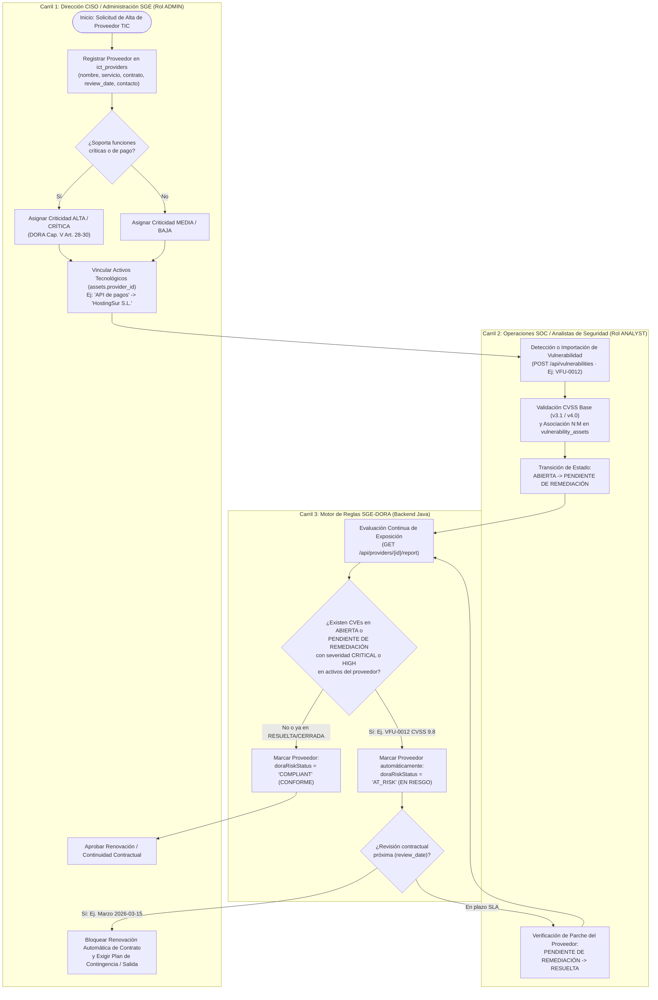

# Módulo SGE — Proceso de Negocio BPMN y Reglas de Riesgo de Proveedores TIC (Reglamento UE DORA)

> **Módulo DAM**: Sistemas de Gestión Empresarial (SGE)  
> **Marco Normativo**: Reglamento (UE) 2022/2554 sobre la resiliencia operativa digital del sector financiero (**DORA — Capítulo V: Gestión del riesgo relacionado con terceros proveedores de servicios TIC**)  
> **Tablas SQL Relacionadas**: [`ict_providers`](file:///c:/Users/luisl/OneDrive/Escritorio/Programacion%20y%20proyectos/VulnFollowUp/database/schema/01_schema.sql#L48-L73) · [`assets`](file:///c:/Users/luisl/OneDrive/Escritorio/Programacion%20y%20proyectos/VulnFollowUp/database/schema/01_schema.sql#L78-L108) · [`vulnerability_assets`](file:///c:/Users/luisl/OneDrive/Escritorio/Programacion%20y%20proyectos/VulnFollowUp/database/schema/01_schema.sql#L194-L209) · [`vulnerabilities`](file:///c:/Users/luisl/OneDrive/Escritorio/Programacion%20y%20proyectos/VulnFollowUp/database/schema/01_schema.sql#L115-L189)

---

## 1. Diagrama de Proceso de Negocio (BPMN / Mermaid Flowchart)

El siguiente diagrama modela el ciclo de vida empresarial completo de un **Proveedor TIC** en **VulnFollowUp**: desde su homologación inicial y clasificación de criticidad DORA, hasta la vinculación con activos tecnológicos, la monitorización continua de vulnerabilidades CVSS v3.1/v4.0 y el **cálculo automático del estado «EN RIESGO» (`AT_RISK`)** previo a la renovación contractual.



---

## 2. Reglas de Negocio y Cálculo Automático del Estado «EN RIESGO» (`AT_RISK`)

En cumplimiento del **Artículo 28 del Reglamento (UE) 2022/2554 (DORA)**, las entidades financieras deben evaluar de forma continua el riesgo operativo derivado de sus proveedores terceros de servicios TIC:

### Regla Determinista de Evaluación (`doraRiskStatus`)
Un proveedor registrado en `ict_providers` pasa automáticamente al estado **`AT_RISK` («EN RIESGO»)** cuando la consulta relacional sobre la cadena `ict_providers` $\rightarrow$ `assets` $\rightarrow$ `vulnerability_assets` $\rightarrow$ `vulnerabilities` devuelve **al menos 1 vulnerabilidad** que cumpla simultáneamente:
1. **Estado activo sin resolver**: `vulnerabilities.status IN ('ABIERTA', 'PENDIENTE DE REMEDIACIÓN')`.
2. **Severidad elevada o crítica**: `vulnerabilities.severity IN ('HIGH', 'CRITICAL')` (es decir, `cvss_score >= 7.0`).

```sql
-- Consulta SQL de verificación SGE-DORA utilizada por GET /api/providers/{id}/report
SELECT
    p.id AS provider_id,
    p.provider_code,
    p.name AS provider_name,
    p.criticality AS provider_criticality,
    p.contract_status,
    p.review_date,
    COUNT(DISTINCT v.id) FILTER (
        WHERE v.status IN ('ABIERTA', 'PENDIENTE DE REMEDIACIÓN')
          AND v.severity IN ('HIGH', 'CRITICAL')
    ) AS active_critical_high_vulns,
    CASE
        WHEN COUNT(DISTINCT v.id) FILTER (
            WHERE v.status IN ('ABIERTA', 'PENDIENTE DE REMEDIACIÓN')
              AND v.severity IN ('HIGH', 'CRITICAL')
        ) > 0 THEN 'AT_RISK'
        ELSE 'COMPLIANT'
    END AS dora_risk_status
FROM ict_providers p
LEFT JOIN assets a ON a.provider_id = p.id
LEFT JOIN vulnerability_assets va ON va.asset_id = a.id
LEFT JOIN vulnerabilities v ON v.id = va.vulnerability_id
GROUP BY p.id, p.provider_code, p.name, p.criticality, p.contract_status, p.review_date;
```

---

## 3. Caso Oficial de Demostración SGE: «HostingSur S.L.» y `VFU-0012`

Para la defensa intermodular, la base de datos ([`database/seed/02_seed_data.sql`](file:///c:/Users/luisl/OneDrive/Escritorio/Programacion%20y%20proyectos/VulnFollowUp/database/seed/02_seed_data.sql)) y el contrato REST ([`docs/api/openapi.yaml`](file:///c:/Users/luisl/OneDrive/Escritorio/Programacion%20y%20proyectos/VulnFollowUp/docs/api/openapi.yaml)) incorporan de serie el escenario empresarial obligatorio:

| Entidad SGE / Seguridad | Identificador | Valor en Base de Datos | Impacto en Proceso de Negocio DORA |
|---|---|---|---|
| **Proveedor TIC** | `PROV-005` (`id = 5`) | **«HostingSur S.L.»** · Criticidad: **`HIGH` (ALTA)** · Revisión prevista: **Marzo (`2026-03-15`)** | Proveedor estratégico sujeto a auditoría de renovación en marzo. |
| **Activo Tecnológico** | `AST-PAY-008` (`id = 8`) | **«API de pagos»** (`API_SERVICE`) · Criticidad: **`HIGH` (ALTA)** · `provider_id = 5` | Servicio crítico de liquidación y cobros alojado en infraestructura de *HostingSur S.L.* |
| **Vulnerabilidad Asociada** | **`VFU-0012`** (`id = 12`) | `CVE-2024-21762` · **CVSS v3.1 = `9.8` (`CRITICAL`)** · Estado: **`PENDIENTE DE REMEDIACIÓN`** | Al encontrarse en estado `PENDIENTE DE REMEDIACIÓN` con nota `9.8`, el motor SGE marca automáticamente a **HostingSur S.L.** como **`AT_RISK` («EN RIESGO»)** y condiciona la revisión contractual de marzo a la transición a `RESUELTA` / `CERRADA`. |
